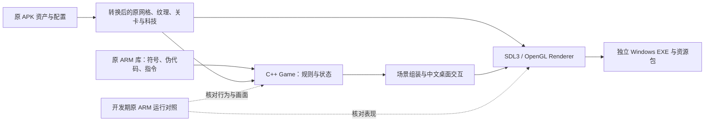

<!-- Frozen native reconstruction route, evidence boundaries, and review decisions. -->
# 当前技术路线审查

本文保留 2026-10-14 的重建路线审查。当前原 x86 开发基线以 [X86_CORE_REUSE.md](X86_CORE_REUSE.md) 和 [BASELINE_AUDIT.md](BASELINE_AUDIT.md) 为准。

2026-10-14 收束基线：P8 保持暂停。本文件供检查现有路线与效果，尚未认定原作保真或 P8 总体完成。本次仅整理已有实现、重新验证和打包。

后续独立实验已证明：原x86核心可在Windows直接绘制PlainPlane，原轮盘建塔、原按钮发波并推进真实战斗。见[X86_CORE_REUSE.md](X86_CORE_REUSE.md)。这为优先推进原核心复用提供实际依据；下文描述的既有C++重建仍保留，发行主线尚未替换。

## 当前如何重建

原 APK 的核心是 Apportable/Verde 移植的 Objective-C 原生游戏，非 Unity。当前没有在 Windows 上执行 Android 库，而是保留原资产与配置，依据符号、反编译及 ARM 指令人工恢复行为，用 C++20 重写玩法，用 SDL3/OpenGL 3.3 绘制原场景。Ghidra 伪代码是恢复依据，不能直接当作完整源码编译。

发布包只需要 EXE、SDL3.dll 和运行资源。Android SDK、APK、模拟器及分析数据库留在开发目录；最终产物为原生 Windows 程序。

| 部分 | 已采用的方法 | 若调整路线，可保留什么 |
| --- | --- | --- |
| 原美术与配置 | 转换原 VBO/CgBI，保留模型矩阵、图集、材质和关卡参数 | 已准备资产、转换工具、配置与引用关系 |
| 玩法 | 固定 25ms 步长，人工恢复寻路、武器、波次、状态、计分与 MT19937 | 规则证据、Game 模块；换引擎仍需适配时间与接口 |
| 表现 | 原模型/材质、静态恢复的动作与特效；独立 realtime 处理短暂事件 | 表现公式和资源；渲染实现需随引擎调整 |
| 桌面交互 | 当前 main.cpp 内的中文菜单、HUD、鼠标键盘、保存与预览 | 桌面流程；这是适配设计，原手机界面未完整复刻 |
| 原作对照 | 项目内 API17 ARM 环境已运行未经修改的原 APK | 已捕获截图与复现说明；仍需更完整、可比的动态场景 |

## 收束后实际达到的范围

12 类武器、四套科技、116 个有限模式、原无限波生成和沙盒已接入。战役推进及桌面附加关卡入口可用；112 个附加关卡的原访问门槛尚未恢复。原相机方向、unlit 材质、塔动作、炮口、敌人行走/死亡、投射物/多层特效已分项接入。

最近一轮已加入原羊群布局与共享随机消费、吃草/转向、追羊/绑架、600ms 转身及 2000ms 升空、阴影、UFO 初角与旋转。最后失羊时先锁操作，继续仿真至最后羊隐藏，再结算；镜头使用预订时的固定羊位置。羊/入侵者/时钟及会话种子进入可选保存扩展。旧或坏扩展保留核心存档，但不能恢复旧羊的完整历史。

| 证据层次 | 当前结论 | 不能据此推导 |
| --- | --- | --- |
| 原资源/静态指令 | 资源及许多算法、矩阵、时序边界有明确来源 | 全程序行为和跨 ABI 浮点结果已一致 |
| 原作动态画面 | 菜单、首关、普通建塔/价格、行走与抓羊、失败画面已留存 | 整局随机消费、同种子回放及逐帧计时已对齐 |
| Windows 验证 | 9 个现有验证入口退出 0；25 项 CPU 检查，116 模式开局/绘制，420 纹理/321 模型，36 Ogg 解码 | 116 关已全部自然通关、原作等价或另一台机器兼容 |
| 生产输入首关 | 原资金 50，26 波、10 羊、235 击杀、1422 分；也覆盖自然失败及重试 | 策略、难度与原作整局结果必然相同 |

原作羊群采样在暂停前已取得稀疏 PNG，见 `agent/codex/p8-original-sheep-runtime/`：`runtime-0016.png` 有 4 生命及抓羊束，`runtime-0024.png` 为失败菜单。该组不是固定仿真步长录像；不能用主机采样间隔证明原作捕获耗时或倍速。Windows 的羊群序列为生产绘制检查，也不能替代原作对照。

## 需要重点判断的大方向

1. **人工恢复是否足够可控。** 符号和原配置帮助恢复，但完整炮塔瞄准双角度、随机初始朝向/idle、发射 gate 及调用顺序仍未闭合；部分死亡/分裂与视觉随机仍采用近似。这会影响战斗轨迹，不能只当作美术差异。
2. **“忠实还原”与桌面适配的界限。** 当前保留原场景资源与方向，但默认镜头 fit、中文 GDI 字体/HUD、关卡库及部分可读性提示是桌面设计。原 pie menu、Menu world 和转场尚未完整还原；需评审当前界面是否符合预期风格。
3. **动态验证是否成为下一阶段主线。** 目前静态恢复和本机自检较多；原作可运行后，仍需以可比场景验证动作、节奏、镜头和难度，不能继续用功能数量或测试条数替代保真验收。
4. **现有渲染器是否能满足目标。** 原资源可在当前 OpenGL 路径绘制；透明排序/深度状态、plasma/flame 屏幕尺寸、诱饵屏幕 aura、条件核爆闪光及范围淡出仍有差异。引擎选择本身不能替代这些语义恢复。

密集长时无限、跨机器/高 DPI、实际声音听感尚未验证。当前高帧率结果来自完整首关及其轻负载峰值，不能证明密集场景性能。购买验证、广告、联网排行/多人不在当前范围。

修改入口见 [DEVELOPMENT.md](DEVELOPMENT.md)，阶段目标见 [P8_GAME_QUALITY_PLAN.md](P8_GAME_QUALITY_PLAN.md)，原运行环境见 [ANDROID_REFERENCE.md](ANDROID_REFERENCE.md)。后续推进方式等待本次路线检查结果。
