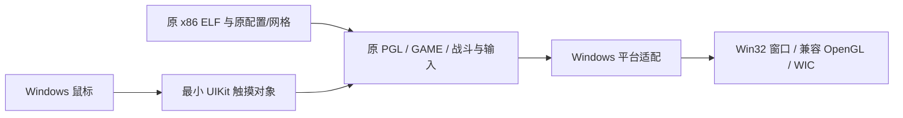

<!-- Native original-code prototype, platform boundaries, and reproduction steps. -->
# 原 x86 核心复用实验

本实验直接在 Windows x86 进程中执行 Zero 1.22 APK 的原 `libverde.so` 及包内依赖。它保留原 JSON-C、资源解析、地图、科技、波次、游戏对象、战斗、动画、PGL 绘制和选塔逻辑，不链接当前 C++ `Game` 或 `Renderer`。现有 `release/TowerMadness.exe` 及存档保持原基线。

已经在本机走通原主菜单、选关、教程、鼠标轮盘建塔、发波战斗、失败结算、本地成绩读回和原 PLAY AGAIN 重试；另有含塔活动波存档恢复证据。尚不代表完整游戏移植或全量保真验收。

## 结构



宿主映射 ELF32 并处理 `R_386_32/PC32/GLOB_DAT/JMP_SLOT/RELATIVE`。机器码由 CPU 直接执行，不使用 CPU 解释器、动态指令模拟、Android 系统或虚拟机。已有 Android 环境不参与实验运行。

Windows 替换的边界为 C 运行库、同步与单线程 GS 存储、文件读取、PNG 上传、GL 调用约定、时钟、触摸对象、默认语言和静音音频。平台入口跳转及 GS 地址修正只作用于当前进程的私有映射，原 APK/库文件不变。未实现的函数导入在实际调用时记录并终止，不用通用成功返回掩盖缺口。

原 GL ES 1 使用固定管线，宿主创建桌面兼容 OpenGL 上下文。原 PNG 优先读取已有的标准化 PNG；原模型、VBO、JSON 配置仍直接读取 APK 解包文件。截图从原渲染的 GL framebuffer 读取，通过 WIC 写入 PNG。

原外层 `EAGLView` 触摸结束函数保留，包含原发波/倍速区域及向 `GAME_touchesEnded` 的转发。宿主仅提供 `count/anyObject/view/tapCount/locationInView:/bounds`。x86 结构体返回适配保留隐藏结果指针的 `ret 4` 约定。

## 使用

需要原 `Madness_Zero-1.22.apk`、项目现有 MSVC/CMake、标准化 PNG 和本地 Ghidra 自带 Capstone。准备阶段不运行游戏；Capstone 只解码生成 GS 元数据，不是运行时依赖。

```powershell
& .\tools\x86-reuse\prepare.ps1
& .\tools\x86-reuse\build.ps1 -BuildDirectory <build dir>
& .\tools\x86-reuse\run.ps1 -Mode play -OutputDirectory <evidence dir>
```

已构建后也可双击 `tools/x86-reuse/play.cmd`。直接进入 PlainPlane；鼠标点击战场/原轮盘建塔，右下原按钮或空格发波，右上原按钮切换速度，关闭窗口退出。固定 480×800、静音、不保存进度。直达关卡模式下的 MENU 按钮仍为 `HOST_PAUSE`（见下）。

原菜单入口使用 `run.ps1 -Mode menu`；该模式持续运行至关闭窗口，Escape返回原菜单。F5/F9为宿主保存/恢复适配，反复换局与对象回收尚待验收。原OBS字节和平台数据写入独立运行包的`data`，开发运行写入输出目录对应的`state`，不会读取旧重建的profile。`-Mode campaign`是隐藏窗口、有界的菜单至终局测试，脚本会请求原API建塔/升级，不能当作纯鼠标通关证据。

`-Map` 选择 `<assets>/<Map>.gamemode`，宿主把它交给原 `GAMEMODE_load`；`-OutputDirectory` 决定日志、trace、result 与 PNG 的根目录，每次运行再建独立时间戳子目录，不覆盖既有证据。

运行模式 `scene` 绘制开局，`input` 用 Windows 鼠标消息操作原轮盘、点原发波按钮并点原倍速热区，`combat` 经原命令建立两座激光塔并发波。新增：`upgrade` 用原 `GAME_buildTower → TOWERS_getIdForCell → GAME_upgradeTower → GAME_sellTower`；`flood` 周期调用原 `GAME_sendNextWave` 直到原 `GAME_hasEnded`；`autoplay` 另用原 `GAME_togglePlaySpeed` 切 4 倍速并发波到底；`levels` 只枚举包内 `*.gamemode`。所有场景每帧查询原 `GAME_hasEnded/GAME_isWon/GAME_getFinalScore/GAME_getFinalLifes`，只有原函数真的报告结束才写终局结果。

原菜单模式：`menu`（可见窗口、真实鼠标、Esc 返回）与 `menuauto`（有界，候选点扫描并截图）。
宿主调用原 `MENU_alloc → MENU_setResolution → MENU_show → MENU_changePage(mainMenuPage)`，随后完全按原外层逻辑运行
`MENU_update/MENU_render` 或 `GAME_update/GAME_render`，终局走 `GAME_hasEnded → GAME_silence → MENU_endGame`；
菜单显示期间不装MENU stub，不手搓替代界面。字符串、容器、日期、账户和UIKit消息由明确的平台适配提供，原GAME/MENU/SCORES机器码不变；这不是完整Foundation运行库复用。未知消息和实际调用的未知导入记录并终止。购买验证、广告和联网排名不属于本次范围。

## 修改入口

| 事项 | 入口 |
| --- | --- |
| ELF、C ABI、触摸及原核心入口 | `tools/x86-reuse/host.cpp` |
| GS 绝对访问解码 | `prepare-gs.ps1`，依赖既有 Capstone 5.0.6 |
| 原库/原资产准备 | `prepare.ps1` |
| GL stdcall/cdecl 参数桥 | `gl-signatures.mjs`，依据项目现有 SDL 官方头文件 |
| 单独构建/运行 | `build.ps1` / `run.ps1` |
| 原菜单只读导出 | `agent/dsh/ghidra-scripts/NativeMenuProbe.java` |

原物理库含23个 ELF；没有初始化完整 Apportable/Objective-C 应用及其所有构造器。只沿原 C 核心调用链初始化 `PGL_init → WAVES_init → GAMEMODE_load → GAME_alloc`。此边界是可行性实验的重要条件，不能描述为完整旧平台已兼容。

## 当前限制与下一步

- 已实测（native 退出码 0）：`levels` 116 关；`scene` PlainPlane/DividedAttention/MuttonsFolly/Madness/AshMountain 五图开局；
  `upgrade` 金钱 50→40→20→50；`flood`/`autoplay`/`input` 均自然结束。命令与判据见 `execution-requests-stage2.md`。
- 原菜单驱动执行原 `MENU_alloc/init/show/render/update/handleTouch*` 与 `MENUWORLD_*`，导出证据在 `agent/dsh/menu-evidence`。
  驱动已构建，原主菜单标题/按钮、选关和战役页可见；原NEW GAME→CAMPAIGN→PlainPlane TAP TO START已创建真实GAME。
  `MENU_setResolution` 接收float逻辑画布尺寸；错误传整数会使UI投影塌缩。原教程、建塔扣款、发波、暂停冻结、有塔活动波恢复及失败结算已有实测；自然胜利和解锁链仍待验。
- 当前 GS 和锁适配针对单线程，Bionic 全线程/TLS/stdio ABI及其他导入尚未完整支持。
- 原菜单选关已接入，设置/Guide、重开和完整外围生命周期仍需交互验收。默认语言返回原文本；音频按用户要求禁用，不能声称音频保真。
- 成绩容器已能跨进程读取并再次保存。原SCORES的load/save使用不同日期纪元，实际selector已核对；宿主保持NSDate语义，原日期漂移仍作为已知问题保留，不代表成绩时间正确。
- HUD字体/屏幕密度、透明状态及驱动/宿主数学库舍入仍需原作对照；不保证逐像素或跨ABI逐位一致。只验证一台Windows机器。
- 原加载器报告未找到 `robosteal_walk0..19.model`，已保留诊断；其原资源回退与对应敌人尚未验。

当前证据支持优先推进原核心复用，先补齐启动/菜单与平台接口并覆盖代表性武器和完整关卡。现有重建仍保留作对照，不因单关通过立即替换发行主线。

旧重建与初始复用实验保存在 Git 标签 `reconstruction-reference-20261014`（`f4e8e08`），原 `src` 与 `release` 保持可参考。
委派开发的固定工作区是 `agent/dsh`；专用桥构建最新副本，产品构建默认仍用 `tools/x86-reuse/host.cpp`。
手工构建副本可传 `build.ps1 -HostSource <absolute-host.cpp> -BuildDirectory <build-directory>`；最终须将已验证副本同步回产品源码。
