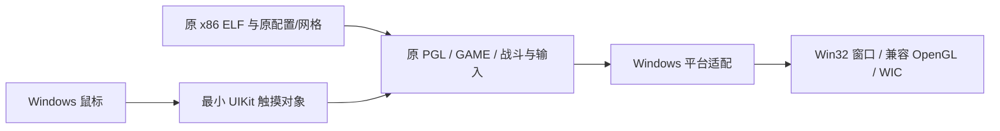

<!-- Native original-code prototype, platform boundaries, and reproduction steps. -->
# 原 x86 核心复用实验

本实验直接在 Windows x86 进程中执行 Zero 1.22 APK 的原 `libverde.so` 及包内依赖。它保留原 JSON-C、资源解析、地图、科技、波次、游戏对象、战斗、动画、PGL 绘制和选塔逻辑，不链接当前 C++ `Game` 或 `Renderer`。现有 `release/TowerMadness.exe` 及存档保持原基线。

已经在本机完成原 PlainPlane 绘制、Windows 鼠标进入原轮盘并建塔、原外层按钮发波，以及真实击杀/奖励/得分。尚不代表完整游戏移植或全量保真验收。

## 结构



宿主映射 ELF32 并处理 `R_386_32/PC32/GLOB_DAT/JMP_SLOT/RELATIVE`。机器码由 CPU 直接执行，不使用 CPU 解释器、动态指令模拟、Android 系统或虚拟机。已有 Android 环境不参与实验运行。

Windows 替换的边界为 C 运行库、同步与单线程 GS 存储、文件读取、PNG 上传、GL 调用约定、时钟、触摸对象、默认语言和静音音频。平台入口跳转及 GS 地址修正只作用于当前进程的私有映射，原 APK/库文件不变。未实现的函数导入在实际调用时记录并终止，不用通用成功返回掩盖缺口。

原 GL ES 1 使用固定管线，宿主创建桌面兼容 OpenGL 上下文。原 PNG 优先读取已有的标准化 PNG；原模型、VBO、JSON 配置仍直接读取 APK 解包文件。截图从原渲染的 GL framebuffer 读取，通过 WIC 写入 PNG。

原外层 `EAGLView` 触摸结束函数保留，包含原发波/倍速区域及向 `GAME_touchesEnded` 的转发。宿主仅提供 `count/anyObject/view/tapCount/locationInView:/bounds`。x86 结构体返回适配保留隐藏结果指针的 `ret 4` 约定。

## 使用

需要原 `Madness_Zero-1.22.apk`、项目现有 MSVC/CMake、标准化 PNG 和本地 Ghidra 自带 Capstone。准备阶段不运行游戏；Capstone 只解码生成 GS 元数据，不是运行时依赖。

```powershell
& .\tools\x86-reuse\prepare.ps1
& .\tools\x86-reuse\build.ps1
& .\tools\x86-reuse\run.ps1 -Mode play
```

已构建后也可双击 `tools/x86-reuse/play.cmd`。直接进入 PlainPlane；鼠标点击战场/原轮盘建塔，右下原按钮或空格发波，右上原按钮切换速度，关闭窗口退出。固定 480×800、静音、不保存进度。原 MENU 按钮目前显示原型说明，不运行完整主菜单。

运行模式 `scene` 绘制开局，`input` 用 Windows 鼠标消息操作原轮盘并点击原发波按钮，`combat` 经原命令建立两座激光塔并发波；后两者运行35秒。`run.ps1`保留独立时间戳日志与真实进程退出码。截图、原统计、逐500ms状态和构建目录位于 `agent/codex/x86-reuse`，不进入发布目录。

## 修改入口

| 事项 | 入口 |
| --- | --- |
| ELF、C ABI、触摸及原核心入口 | `tools/x86-reuse/host.cpp` |
| GS 绝对访问解码 | `prepare-gs.ps1`，依赖既有 Capstone 5.0.6 |
| 原库/原资产准备 | `prepare.ps1` |
| GL stdcall/cdecl 参数桥 | `gl-signatures.mjs`，依据项目现有 SDL 官方头文件 |
| 单独构建/运行 | `build.ps1` / `run.ps1` |

原物理库含23个 ELF；没有初始化完整 Apportable/Objective-C 应用及其所有构造器。只沿原 C 核心调用链初始化 `PGL_init → WAVES_init → GAMEMODE_load → GAME_alloc`。此边界是可行性实验的重要条件，不能描述为完整旧平台已兼容。

## 当前限制与下一步

- 只验证 PlainPlane 短局、激光和迫击炮及这条交互路径；全部武器/关卡、胜负、升级/出售、长局及保存未验。
- 当前 GS 和锁适配针对单线程，Bionic 全线程/TLS/stdio ABI及其他导入尚未完整支持。
- 主菜单、关卡选择、设置和原外围生命周期未移植。默认语言返回原文本；音频按用户要求禁用，不能声称音频保真。
- HUD字体/屏幕密度、透明状态及驱动/宿主数学库舍入仍需原作对照；不保证逐像素或跨ABI逐位一致。只验证一台Windows机器。
- 原加载器报告未找到 `robosteal_walk0..19.model`，已保留诊断；其原资源回退与对应敌人尚未验。

当前证据支持优先推进原核心复用，先补齐启动/菜单与平台接口并覆盖代表性武器和完整关卡。现有重建仍保留作对照，不因单关通过立即替换发行主线。
